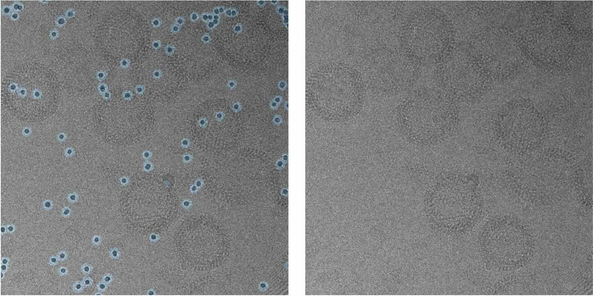

# torch-cryoeraser

[](https://github.com/teamtomo/teamtomo/blob/main/packages/algorithms/torch-cryoeraser/LICENSE)
[](https://pypi.org/project/torch-cryoeraser)
[](https://python.org)
[](https://github.com/teamtomo/teamtomo/actions/workflows/ci.yml)

*torch-cryoeraser* is a Python package for erasing local regions of cryo-EM images.


<p align="center">
  
</p>

Image data in masked regions are replaced with noise matching local image statistics.

## Installation

```bash
pip install torch-cryoeraser
```

## Usage

```python
import torch
import tifffile
from torch_cryoeraser import erase_region_2d

# load image and mask
image = tifffile.imread("image.tif")
mask = tifffile.imread("mask.tif")

# to torch tensor
image = torch.tensor(image)
mask = torch.tensor(mask)

# erase masked regions
erased_image = erase_region_2d(image=image, mask=mask)
```

For more information, see the [documentation](https://teamtomo.org/docs/algorithms/torch-cryoeraser/).
