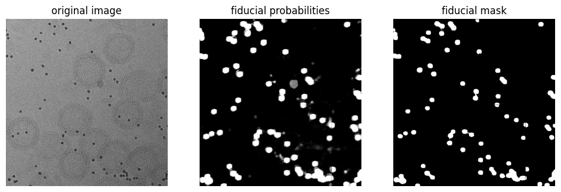

# torch-segment-fiducials-2d

[](https://github.com/teamtomo/teamtomo/blob/main/packages/algorithms/torch-segment-fiducials-2d/LICENSE)
[](https://pypi.org/project/torch-segment-fiducials-2d)
[](https://python.org)
[](https://github.com/teamtomo/teamtomo/actions/workflows/ci.yml)

A small pre-trained residual U-Net for gold fiducial segmentation in cryo-EM images.


<p align="center">
  
</p>

## Installation

```bash
pip install torch-segment-fiducials-2d
```

## Usage

`predict_fiducial_mask` segments gold fiducials in one or more `(..., h, w)`
images. Images are rescaled to the model's training pixel spacing (8 Å/px)
internally, so pass the pixel spacing of your data. The pretrained model is
downloaded from Zenodo on first use and cached.

```python
import torch
from torch_grid_utils import circle
from torch_segment_fiducials_2d import predict_fiducial_mask

# A synthetic 1024 x 1024 image at 4 Å/px with three dark 10 nm gold beads
image = torch.randn(1024, 1024)
for y, x in [(200, 300), (600, 700), (850, 150)]:
    bead = circle(radius=12.5, image_shape=(1024, 1024), center=(y, x), smoothing_radius=1)
    image = image - 4 * bead

mask = predict_fiducial_mask(image, pixel_spacing=4.0, probability_threshold=0.5)
```

`predict_fiducial_probabilities` returns the per-pixel probabilities instead of
a thresholded mask. Inference uses a GPU when one is available.
